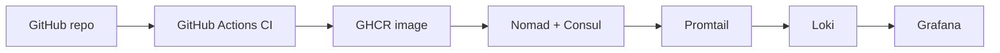
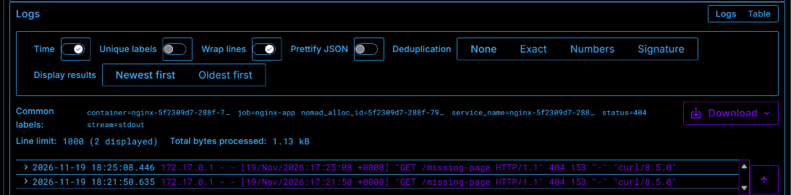

# DevOps Intern Final Assessment


**Name:** Onyinye Ilechukwu | **Submission date:** 2026-11-19

A containerised NGINX app taken through Git, scripts, a Docker image, CI, Nomad and Loki.

## Architecture



## Prerequisites

Git 2.43.0, Docker 29.1.3 (with Compose), ShellCheck 0.9.0, Nomad 2.1.1, Consul 2.1.0. Loki 3.3.2, Promtail 3.3.2 and Grafana 11.4.0 are pinned in the compose file. Tested on Ubuntu 24.04 (WSL2).

## Quick Start

Run locally (4 commands):

```bash
git clone https://github.com/onyinyeilechukwu-prog/devops-intern-final.git && cd devops-intern-final
docker build --build-arg BUILD_SHA=$(git rev-parse HEAD) -t devops-intern-app app
docker run -d --name devops-intern-app -p 8080:8080 devops-intern-app
./scripts/healthcheck.sh
```

Run on Nomad with logs (4 more; the first two need their own terminals). The tag must be a commit SHA that CI pushed to GHCR:

```bash
consul agent -dev
sudo nomad agent -dev
nomad job run -var="image_tag=449cd9b7fb5a798daa72c0d0e5dd5ea33c503fb6" nomad/nginx-app.nomad.hcl
docker compose -f monitoring/docker-compose.yaml up -d
```

## Task 1: Source control

Work was done on `feature/*` branches and merged by pull requests with a description and a self-review. Merges kept the individual commits (no squash). Commits use Conventional Commits. Tagged `v1.0.0`.

The starter app is [ImHype/nginx](https://github.com/ImHype/nginx) (MIT, commit `f883ec3`; licence in `docs/LICENSE-ImHype-nginx.txt`). I changed the Dockerfile, added `nginx.conf` and replaced the page. The starter had no Kubernetes manifests.

## Task 2: Scripts

Both use `#!/usr/bin/env bash` and `set -euo pipefail`, are executable in Git and pass ShellCheck (`shellcheck scripts/*.sh` printed nothing but `no issues` from my wrapper).

```bash
./scripts/sysinfo.sh
```

```text
User:            onyinye (effective UID 1000)
Hostname:        DESKTOP-BK6GF7R
Kernel release:  6.18.58.1-microsoft-standard-WSL2
Date (ISO-8601): 2026-11-19T18:05:46Z
Disk usage:      /dev/sdd 1007G total, 23G used, 934G available (3%)
Memory usage:    7.7Gi total, 3.3Gi used, 4.3Gi available
Docker daemon:   running
```

(Shortened: the real script prints the full `df -h` and `free -h` tables.)

`healthcheck.sh [URL]` defaults to `http://localhost:8080` and exits 0 only on HTTP 200:

```text
FAIL: http://localhost:8080 returned '000', expected 200     (exit code 1, nothing running)
OK: http://localhost:8080 returned 200                       (exit code 0, app running)
```

## Task 3: Container image

Pinned base `nginx:1.27-alpine-slim`, custom `nginx.conf` on port 8080 with `/healthz`, non-root user, `EXPOSE 8080`, `HEALTHCHECK`, and `BUILD_SHA` shown on the page.

```bash
docker build --build-arg BUILD_SHA=$(git rev-parse HEAD) -t devops-intern-app app
docker run -d --name devops-intern-app -p 8080:8080 devops-intern-app
```

Image size: 19.5 MB on disk (5.45 MB compressed), under the 60 MB limit.

```text
$ curl -i http://localhost:8080/healthz
HTTP/1.1 200 OK
Content-Type: text/plain
ok

$ curl -s http://localhost:8080/ | grep "<p>"
<p>Name: Onyinye Ilechukwu</p>
<p>Assessment date: 2026-11-19</p>
<p>Build: 3b47c2fe38618aec66c111179298a87643146185</p>

$ docker inspect -f '{{.State.Health.Status}}' devops-intern-app
healthy
$ docker exec devops-intern-app id
uid=101(nginx) gid=101(nginx) groups=101(nginx)
```

## Task 4: CI

`.github/workflows/ci.yml` runs on push and pull request to `main`: `lint` (ShellCheck, Hadolint), `build` (`BUILD_SHA=${{ github.sha }}`), `test` (starts the image, waits, runs `healthcheck.sh`) and `publish` (push to `main` only, to `ghcr.io/onyinyeilechukwu-prog/devops-intern-final` as `<commit SHA>` and `latest`). Actions are pinned to a version, permissions are read-only except `packages: write` on `publish`, and login uses the built-in `GITHUB_TOKEN`.

On the pull request, `lint`, `build` and `test` passed and `publish` was skipped by design. After the merge all four jobs passed. The package is public:

```text
$ docker pull ghcr.io/onyinyeilechukwu-prog/devops-intern-final:latest
Digest: sha256:08c05488070631c2e95c881d949e54aa4512710c278d47dc0a49b76d5a165123
Status: Downloaded newer image for ghcr.io/onyinyeilechukwu-prog/devops-intern-final:latest
```

## Task 5: Nomad

`nomad/nginx-app.nomad.hcl`: a `service` job, one group and task, Docker driver, image tag from an HCL variable with no default, 100 MHz and 64 MB, dynamic port `http` to 8080, a Consul check on `/healthz` (10s interval, 2s timeout), an `update` block (`max_parallel=1`, `min_healthy_time=10s`, `healthy_deadline=2m`, `auto_revert=true`), and `restart` and `reschedule` policies.

```bash
nomad job validate -var "image_tag=449cd9b7fb5a798daa72c0d0e5dd5ea33c503fb6" nomad/nginx-app.nomad.hcl
nomad job plan     -var "image_tag=449cd9b7fb5a798daa72c0d0e5dd5ea33c503fb6" nomad/nginx-app.nomad.hcl
nomad job run -check-index 0 -var="image_tag=449cd9b7fb5a798daa72c0d0e5dd5ea33c503fb6" nomad/nginx-app.nomad.hcl
```

```text
Job validation successful      (with a warning that shutdown_delay is not set)

+ Job: "nginx-app"
+ Task Group: "web" (1 create)
Scheduler dry-run:
- All tasks successfully allocated.
```

The `run` output was not captured; the final state is below.

```bash
nomad job status nginx-app
```

```text
Status = running
Task Group  Queued  Starting  Running  Failed  Complete  Lost  Unknown
web         0       0         1        0       0         0     0

Latest Deployment
ID          = 2bb31a16
Status      = successful
Description = Deployment completed successfully
Task Group  Auto Revert  Desired  Placed  Healthy  Unhealthy
web         true         1        1       1        0

Allocations
ID        Node ID   Task Group  Version  Desired  Status   Created  Modified
eb34d136  83da3eaf  web         0        run      running  37s ago  19s ago
```

(Shortened.) Consul reported the check as `"Status": "passing"`, and the app answered on Nomad's port with `Build: 449cd9b7...`, the deployed tag.

## Task 6: Loki

`monitoring/docker-compose.yaml` runs Loki, Promtail and Grafana with the committed `loki-config.yaml` and `promtail-config.yaml`. Promtail labels each line with `job`, `container`, `nomad_alloc_id` and `stream`. Details: [`monitoring/loki_setup.md`](monitoring/loki_setup.md).

Query for NGINX requests that did not return 200, after requesting `/missing-page`:

```text
{job="nginx-app"} | regexp `"\w+ \S+ \S+" (?P<status>\d+)` | status != 200
```



## Troubleshooting

| Problem | Fix |
| --- | --- |
| `healthcheck.sh` returned `404` with nothing of mine running: another project's container held port 8080 | Stopped that project's containers |
| `/` returned 404 but `/healthz` worked: `try_files $uri =404` skipped the folder | Changed to `try_files $uri $uri/ =404` |
| Image was 73.7 MB, over the 60 MB limit | Switched base to `nginx:1.27-alpine-slim` (19.5 MB) |
| Grafana Explore showed no lines: range was "Last 15 minutes", requests were older | Set "Last 1 hour" |
| Grafana first said `Unable to connect with Loki` (cause not recorded; passed on retry) | Use `http://loki:3100`, not `localhost` |

## Known Limitations

- Nomad and Consul run in `-dev` mode on one machine.
- The GHCR package is public so Nomad can pull it without credentials.
- Loki keeps logs inside its container, and Grafana uses its default `admin` login (local only).
- I believe Promtail is deprecated in favour of Grafana Alloy; the task specifies it.
- Promtail logged `entry too far behind` for lines dated 14 November on first start. Their source was not identified.
- Scripts need `bash`, because `dash` has no `pipefail`.
