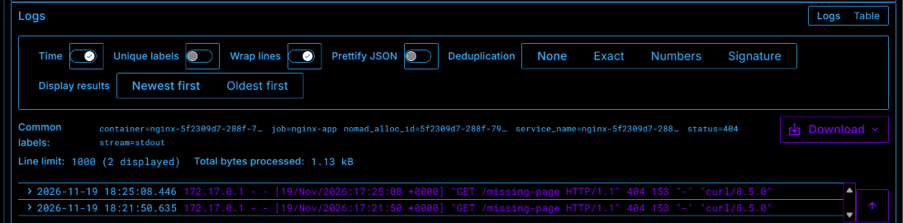

# Loki setup

## How it was started

Nomad and Consul run on the host in dev mode. Nomad runs the NGINX container. From the repo root:

    docker compose -f monitoring/docker-compose.yaml up -d

This starts Loki 3.3.2 (port 3100), Promtail 3.3.2 and Grafana 11.4.0 (port 3000). Promtail finds containers through the Docker socket and sends their logs to Loki. In Grafana, a Loki data source with URL `http://loki:3100` was added by hand (Connections > Data sources).

## Labels

| Label | Source | Purpose |
| --- | --- | --- |
| `job` | fixed value `nginx-app` | Select the app's logs |
| `container` | Docker container name | Which container wrote the line |
| `nomad_alloc_id` | cut from the container name `nginx-<alloc id>` | Ties a line to a Nomad allocation |
| `stream` | Docker log stream | `stdout` (access log) or `stderr` (error log) |

Promtail keeps only containers whose name starts with `nginx-`, so other containers are not collected.

## Queries

All logs of the app:

    {job="nginx-app"}

NGINX requests that did not return 200:

    {job="nginx-app"} | regexp `"\w+ \S+ \S+" (?P<status>\d+)` | status != 200

The `regexp` stage pulls the status code out of each access-log line, and the last stage keeps lines where it is not 200.

## Results

After `curl http://localhost:<port>/missing-page` returned 404, the query above showed only the 404 lines (for example `"GET /missing-page HTTP/1.1" 404 153`) and none for `/` (200). `/healthz` has `access_log off`, so it never appears. Asking Loki's API for the values of the `container` label returned only the Nomad container.

## Problems

1. **Old log lines rejected.** When Promtail first started, Loki and Promtail logged `entry too far behind` errors for lines dated 14 November. Loki only accepts lines from roughly the last hour. The `container` label held only the Nomad container, so the app's own logs were not affected. The source of those old lines was not identified.
2. **Grafana could not connect to Loki** on the first "Save & test" (`Unable to connect with Loki`). It passed on a retry after re-checking the URL. The exact cause was not recorded. Loki must be addressed as `http://loki:3100`, not `localhost`, because Grafana reaches it inside the compose network.
3. **Explore showed no lines.** The time range was "Last 15 minutes", but the test requests had been made about 30 minutes earlier. Setting it to "Last 1 hour" fixed it.
4. **Query pasted into the terminal.** LogQL belongs in the Grafana query box, not in a shell.

## Limitations

- Loki stores logs inside its container, so they are lost when the container is removed.
- Grafana keeps its default `admin` / `admin` login, for local use only.
- Promtail is the tool the task specifies, but I believe it is deprecated in favour of Grafana Alloy.
